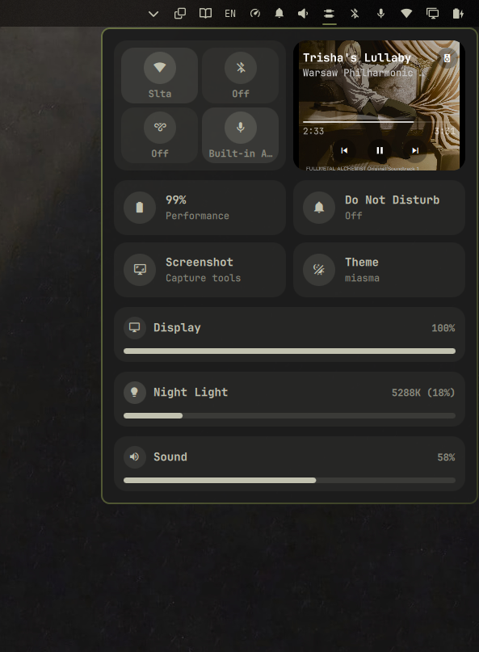

# OmaCenter

OmaCenter is a modular Omarchy shell control center. It presents common system controls in one panel, with expandable modules for settings that need more room.

## Features

- Connectivity: Wi-Fi, Bluetooth, Tailscale, and microphone controls.
- Focus and media: Do Not Disturb, per-player media controls and volume, battery and power profiles, quick theme switching, sound-output selection, and screenshots.
- System controls: output volume, display brightness and monitor settings, and night-light warmth.
- Modules are discovered from `modules/*/module.json` and laid out by `layout_manager.py`.

Some features depend on the corresponding system service or utility being installed and available (for example, NetworkManager, Bluetooth, Tailscale, PipeWire, or UPower).



## Install

OmaCenter requires Omarchy and its Quickshell-based shell. Once this repository is published, install it with Omarchy's plugin manager, replacing the URL with this repository's GitHub clone URL:

```sh
omarchy plugin add https://github.com/SaifOmar/OmaCenter.git --enable
```

The plugin manager installs the plugin and enables the `so.omacenter` bar widget. If it does not appear immediately, restart the shell:

```sh
omarchy restart shell
```

## Update

Update the installed Git-managed plugin with:

```sh
omarchy plugin update so.omacenter
```

If the update does not appear in the shell, restart it with `omarchy restart shell`.

## Development

The panel is defined in `Panel.qml`; reusable controls live under `modules/`. Each module has a `module.json` descriptor, a collapsed entry point, and optionally an expanded panel. `layout_manager.py` discovers and validates the module descriptors before the panel loads them.

Run the layout-manager tests from the repository root with:

```sh
python3 -m unittest discover -s tests
```
